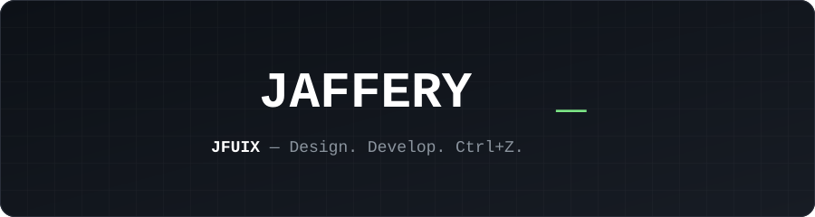
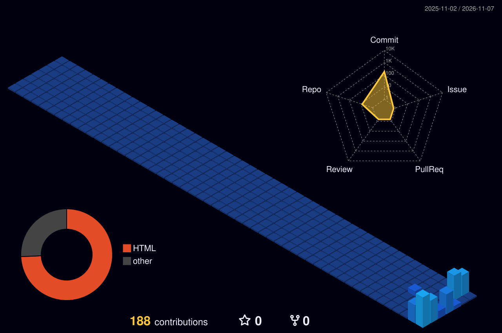

  

**Building digital experiences for startups and growing brands.**

*Turning business ambitions into experiences.*

  

  

  

## Languages used

**HTML · CSS · JavaScript · TypeScript**

The chart names each language detected in my public project repositories. Its percentages reflect source-code bytes, not proficiency; GitHub counts inline CSS and JavaScript inside HTML files as HTML.

## Selected Projects

### 1. Artiosis | Creative Technology Agency

**Turning ambitious ideas into digital experiences.**

The official Artiosis website, live on its custom domain. Features a dark teal identity, three service pillars, a softly glowing logo dot, four edge-to-edge portfolio category sliders, and dedicated project collections with detailed case studies.

[Live website](https://artiosis.com/) · [Portfolio](https://artiosis.com/work.html) · [Repository](https://github.com/JFUIX/Artiosis)

Built with **Next.js, React, TypeScript, HTML, CSS, and JavaScript** · Hosted on **Vercel**.

### 2. HustleWise

A project discovery and assessment platform concept that helps founders and business owners understand their next steps, identify the support they need, and discover relevant people and services. Features a guided assessment, project readiness report, and sample provider directory.

[Live demo](https://jfuix.github.io/HustleWise/) · [Repository](https://github.com/JFUIX/HustleWise)

### 3. Ad Campaign Assistant

An AI-assisted marketing tool for campaign ideation, creative angles, headline generation, testing checklists, and reviewing campaign performance screenshots.

[Live demo](https://jfuix.github.io/adcampaign-assistant/) · [Repository](https://github.com/JFUIX/adcampaign-assistant)

### 4. Gain Shred Gym

A gym website concept featuring membership information and an interactive BMI calculator.

[Live demo](https://jfuix.github.io/Gainshred/) · [Repository](https://github.com/JFUIX/Gainshred)

### 5. CrumbleCookies by Tim

A dark, dreamy bakery website concept showcasing a distinctive visual identity and an online ordering experience.

[Live demo](https://jfuix.github.io/CrumbleCookiesbyTim/) · [Repository](https://github.com/JFUIX/CrumbleCookiesbyTim)

### 6. The Shane Foundation

An editorial-style nonprofit homepage redesign concept focused on blood-clot awareness, accessible information, research, and donation pathways. Demonstrates responsive front-end development and a strong visual direction.

[Live demo](https://jfuix.github.io/TSF/) · [Repository](https://github.com/JFUIX/TSF)

