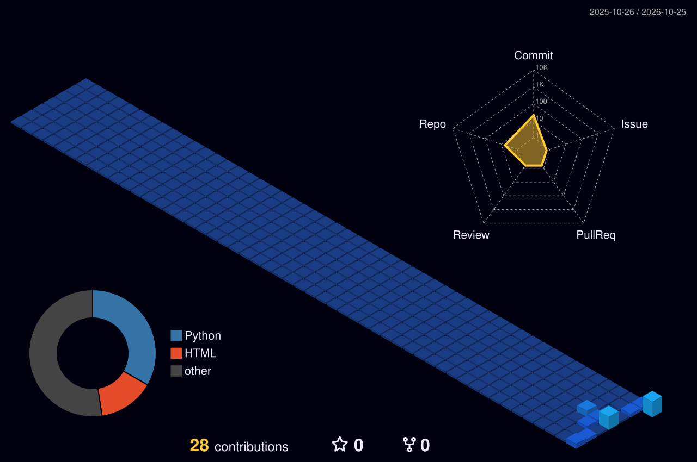

  

**Building digital experiences for startups and growing brands.**

*Turning business ambitions into experiences.*

  

  

 

  

## Selected Projects

### GainShred Gym

Gym website concept featuring membership information and a BMI calculator. [Live demo](https://jfuix.github.io/Gainshred/) · [Repository](https://github.com/JFUIX/Gainshred)

### The Shane Foundation

Independent, editorial-style nonprofit homepage redesign concept focused on blood-clot awareness, responsive navigation, research, and donation pathways. [Live demo](https://jfuix.github.io/NGO-TSF/) · [Repository](https://github.com/JFUIX/NGO---TSF)

### Ad Campaign Assistant

AI-assisted campaign planning and ad-performance review, with creative angles, headline ideas, testing checklists, and screenshot-based campaign analysis. [Live demo](https://jfuix.github.io/adcampaign-assistant/) · [Repository](https://github.com/JFUIX/adcampaign-assistant)

### CrumbleCookies by Tim

Dark, dreamy cookie bakery website concept. [Live demo](https://jfuix.github.io/CrumbleCookiesbyTim/) · [Repository](https://github.com/JFUIX/CrumbleCookiesbyTim)

